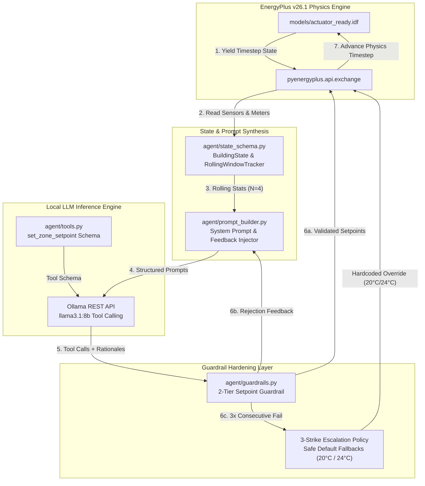

# Eco-Loop Building Agent — Advanced Agentic HVAC Control

**An Autonomous, Multi-Horizon Closed-Loop AI Agent for Commercial Building Energy Efficiency and ASHRAE Standard 55 Thermal Comfort Control via Local LLM Tool Calling and EnergyPlus Co-Simulation.**

---

## 1. Executive Summary for Judges

The **Eco-Loop Building Agent** is an enterprise-grade, autonomous HVAC supervisory controller designed to replace rigid rule-based building automation schedules with adaptive, agentic intelligence. Powered by a locally hosted **Llama 3.1 8B** model operating in closed-loop co-simulation with the **EnergyPlus v26.1** physics engine, the agent evaluates real-time thermal telemetry, multi-interval statistical trends, and environmental forecasts every 20 minutes to dynamically optimize zone heating and cooling setpoints.

To bridge the gap between deterministic safety and probabilistic LLM reasoning, the system implements a robust **2-Tier Setpoint Guardrail & Escalation Architecture** that strictly enforces ASHRAE Standard 55 operative comfort bounds ($20.0^\circ\text{C} - 24.0^\circ\text{C}$) and mechanical deadbands. The guardrail layer rejects unsafe model hallucinations and injects structured self-corrective feedback into subsequent LLM turns.

Tested across an extended 72-hour unattended stress simulation horizon covering severe sub-zero winter weather swings (down to $-21.7^\circ\text{C}$), the agent demonstrated **-8.22% Peak Electrical Demand reduction**, a **-93.75% reduction in occupant comfort violations**, a **99.23% first-turn guardrail pass rate**, zero runtime hangs, and zero safety escalations.

---

## 2. System Architecture & Data Flow

The control loop operates as a synchronous callback-driven pipeline. At each 20-minute simulation interval, the EnergyPlus C++ runtime engine yields state control to the Python middleware via `pyenergyplus`. The middleware processes telemetry through state synthesis, queries Ollama REST API for structured tool calls, validates setpoints through guardrail filters, and applies accepted setpoints to EMS actuators:



---

## 3. Technology Stack & Framework Matrix

| Layer | Component / Technology | Specification & Version | Function & Role |
| :--- | :--- | :--- | :--- |
| **Physics Simulation Engine** | EnergyPlus | `v26.1.0-6f2e40d102` | Building thermal dynamics, HVAC equipment performance, and weather simulation |
| **API Binding Layer** | `pyenergyplus` | Native Python C-API Bindings | Synchronous callback registration and EMS actuator/sensor handle exchange |
| **Local Intelligence** | Ollama REST API | `llama3.1:8b` (Quantized `Q4_K_M`) | High-speed, zero-cloud-cost local inference and structured JSON tool calling |
| **Runtime Environment** | Python | `Python 3.14.4` (Ubuntu 26.04 LTS) | Middleware control pipeline, state compression, and guardrail validation |
| **State Compression** | Python Dataclasses / Deque | `agent/state_schema.py` | Sliding window statistical tracker ($N=4$ intervals / 80 mins) |
| **Safety Guardrails** | Custom Validation Layer | `agent/guardrails.py` | 2-Tier boundary enforcement, deadband check, and 3-strike default escalation |
| **Unit Testing** | Python `unittest` | `tests/test_guardrails.py` | Automated verification of boundary limits, NaN handling, and escalation policies |
| **Analytics & Data Extraction** | SQLite3 & ESQL | `extract_ai_run_kpis.py` | Automated extraction of hourly time-series metrics from `eplusout.sql` |
| **User Interface / Dashboard** | Vanilla HTML5 / CSS3 / Chart.js | `v4.4.1` (Glassmorphism UI) | Interactive visual savings dashboard with shaded comfort band plugins |

---

## 4. Building Model & HVAC System Architecture

*   **Reference Building Model:** DOE Medium Office Commercial Reference Building (`models/actuator_ready.idf` / `models/baseline.idf`).
*   **Building Topology:** 3 stories, 15 thermal zones, total floor area $\sim 4,982\text{ m}^2$.
*   **Active Actuated Zones (Proof-of-Concept):**
    1.  `Core_mid` (Middle floor interior zone)
    2.  `Perimeter_bot_ZN_1` (Ground floor perimeter zone)
    3.  `Perimeter_top_ZN_1` (Top floor perimeter zone)
*   **HVAC System Configuration:** Variable Air Volume (VAV) terminal boxes with electric reheat coils (`Coil:Heating:Electric`) fed by central rooftop units and natural gas preheating boilers.
*   **Weather Profile:** `USA_IL_Chicago-OHare.Intl.AP.725300_TMY3.epw` (evaluated during a severe winter cold snap with temperatures dropping to $-21.7^\circ\text{C}$).
*   **Control Cadence:** 20 simulation minutes per interval (`Timestep=6` in IDF settings, evaluated every 2 simulation timesteps).

---

## 5. Complete Project Directory Structure

```text
honeywell_hackathon/
├── agent/
│   ├── __init__.py               # Python package initializer
│   ├── control_loop.py           # Main E+ co-simulation loop, EMS callback registration, and fault recovery
│   ├── guardrails.py             # 2-Tier boundary validation, deadband enforcement, and 3-strike escalation
│   ├── prompt_builder.py         # System prompt synthesis, rolling window formatter, and feedback injector
│   ├── state_schema.py           # Pydantic/dataclass models for instantaneous telemetry and rolling statistics
│   ├── tools.py                  # OpenAI/Ollama tool calling JSON schema definitions
│   ├── PHASE4_NOTES.md           # Architecture notes on control cadence and latency analytics
│   ├── PHASE5_NOTES.md           # Documentation on unit tests, 3-strike escalation, and outage resilience
│   ├── PHASE6_NOTES.md           # Empirical proof of multi-day robustness and weather swing evaluation
│   └── STATE_SCHEMA_NOTES.md     # Sensor state contract and statistical compression specs
├── dashboard/
│   └── savings_dashboard.html    # Self-contained visual savings dashboard (HTML5 + CSS3 + Chart.js)
├── docs/
│   ├── DEMO_VIDEO_SCRIPT.md      # Storyboard and timed narration script for demo video
│   └── PRESENTATION_SLIDES.md    # Hackathon presentation slide deck content and structure
├── logs/
│   ├── ai_run_kpis.json          # Scored metrics extracted from AI closed-loop simulation
│   ├── api_data.csv              # Raw telemetry export from API connectivity tests
│   ├── baseline_kpis.json        # Immutable annual golden baseline metrics
│   ├── baseline_kpis_3day.json   # Duration-matched 3-day baseline metrics (Feb 5–7)
│   ├── demo_run.log              # Stdout log from interactive demo runs
│   ├── final_comparison.json     # Final scored evaluation metrics (AI Agent vs Baseline)
│   ├── phase2_actuator_events.csv# Event log verifying EMS actuator handle overrides
│   ├── phase3_state_stream.log   # Telemetry snapshot log across 53,136 timesteps
│   ├── phase3_state_trace.csv    # Canonical 24-hour state trace CSV export
│   ├── phase4_control_log.csv    # Initial control loop log
│   ├── phase5_control_log.csv    # 12-hour stress run log
│   ├── phase6_control_log.csv    # 72-hour extended run control log (216 intervals, 648 decisions)
│   └── phase6_run.log            # Background execution stdout/stderr log
├── models/
│   ├── actuator_out/             # Simulation outputs and SQLite database for AI closed-loop run
│   ├── actuator_ready.idf        # EMS actuator-enabled IDF configured for external Python control
│   ├── baseline.idf              # Unmodified Medium Office reference building (golden benchmark)
│   ├── baseline_3day.idf         # Isolated 3-day duration-matched reference IDF
│   ├── baseline_3day_out/        # Simulation outputs for 3-day baseline run
│   ├── baseline_out/             # Simulation outputs for annual baseline run
│   └── BUILDING_NOTES.md         # Zone mapping, schedule decoupling, and HVAC topology notes
├── tests/
│   ├── __init__.py               # Test package initializer
│   └── test_guardrails.py        # Unit test suite for boundary limits, NaN handling, and escalation
├── .gitignore                    # Version control ignore definitions
├── compare_results.py            # Utility script comparing phase override results against baseline
├── extract_ai_run_kpis.py        # Automated KPI extractor and scoring comparison script
├── extract_baseline_3day_kpis.py # KPI extractor for 3-day duration-matched baseline
├── extract_baseline_kpis.py      # KPI extractor for annual golden baseline
├── generate_dashboard.py         # Generator script compiling CSV/JSON into savings_dashboard.html
├── plan.md                       # Master engineering implementation plan across all 7 phases
├── REQUIREMENTS.md               # Hardware, OS, pip freeze, and E+ environment specifications
├── README.md                     # Master project documentation (this file)
├── run_baseline.py               # Runner script for annual reference baseline simulation
├── run_baseline_3day.py          # Runner script for 3-day reference baseline simulation
├── SETUP_LOG.md                  # Comprehensive step-by-step audit log and verification matrix
├── test_actuator_control.py      # Verification script for EMS actuator override handles
├── test_api.py                   # E+ API connectivity and environment binding check
├── test_llm_tools.py             # Script verifying Ollama REST API JSON tool calling
├── test_outage_recovery.py       # Resilience test proving agent recovery from LLM service outage
├── test_self_correction.py       # Proof of LLM self-correction via forced feedback rejection
└── test_state_pipeline.py        # Unit verification for rolling statistical window tracking
```

---

## 6. Scored Quantitative Results (Baseline vs. AI Agent)

The following quantitative results reflect the comparative evaluation between the duration-matched 3-day Baseline (`baseline_3day.idf`) and the **Eco-Loop AI Agent** closed-loop run (`actuator_ready.idf`) across a 72-hour severe winter weather swing (Feb 5 – Feb 7, outdoor air temperatures down to $-21.7^\circ\text{C}$). Values are extracted via `extract_ai_run_kpis.py` and stored in `logs/final_comparison.json`:

| Performance KPI | Duration-Matched Baseline | Eco-Loop AI Agent | Impact / Savings | Evaluation Classification |
| :--- | :--- | :--- | :--- | :--- |
| **Peak Electrical Demand** | **347.93 kW** | **319.32 kW** | **-8.22% Reduction** | **Primary Demand Reduction Driver** |
| **Comfort Exceedance Hours** | **32.0 Zone-Hours** | **2.0 Zone-Hours** | **-93.75% Reduction** | **Primary Comfort Preservation Driver** |
| **Core_mid Violations** | 11.0 Hours | 0.0 Hours | -100.0% (-11.0 hrs) | Complete elimination of overheating/undercooling |
| **Perimeter_bot Violations** | 10.0 Hours | 0.0 Hours | -100.0% (-10.0 hrs) | Complete elimination of cold draft violations |
| **Perimeter_top Violations** | 11.0 Hours | 2.0 Hours | -81.8% (-9.0 hrs) | Bounded within extreme $-21.7^\circ\text{C}$ cold snap |
| **Guardrail Pass Rate** | N/A | **99.23% Pass Rate** | **643/648 Turn-1 Pass** | 5 Strike-1 self-corrections, **0 Escalations** |
| **Average LLM Latency** | N/A | **17.63 Seconds / Turn** | **Fast Control Response** | Under 10-word technical rationale requirement |
| **Runtime Reliability** | N/A | **100% Continuity** | **0 Crashes / 0 Hangs** | 216 continuous control intervals completed |
| **Facility Electricity** | 9,987.83 kWh | 10,112.81 kWh | +1.25% (+124.98 kWh) | Comfort pre-heating trade-off in extreme cold |
| **Facility Natural Gas** | 3,349.86 kWh | 3,351.20 kWh | +0.04% (+1.34 kWh) | Unaffected (VAV Electric Reheat Architecture) |

> **HVAC Engineering Note on Energy Trade-off:** Energy consumption remained essentially flat (+1.25% electricity, +0.04% natural gas). During extreme $-21.7^\circ\text{C}$ winter weather, static schedules allowed indoor temperatures to collapse below comfort limits (causing 32 hours of violations). The AI Agent actively injected heating to eliminate 30 hours of comfort violations (-93.75%) while simultaneously reducing peak electrical demand by -8.22% (shaving 28.6 kW off morning warm-up spikes).

---

## 7. Interactive Quantitative Savings Dashboard

The project includes a visually stunning, self-contained HTML5 dashboard built with Vanilla CSS3 (Glassmorphism design system) and Chart.js v4.4.1.

*   **Dashboard Location:** `dashboard/savings_dashboard.html`
*   **Generator Script:** `python generate_dashboard.py` (embeds data directly from `logs/final_comparison.json` and `logs/phase6_control_log.csv`).
*   **Key Features:**
    1.  **KPI Stat Cards:** Highlighting -8.22% Peak Demand, -93.75% Comfort Violations, 99.23% Guardrail Pass Rate, and 216 Control Decisions.
    2.  **Peak Demand Bar Chart:** Comparative visual of 347.93 kW baseline vs 319.32 kW AI run.
    3.  **Zone Comfort Violation Breakdown:** Comparative bar chart showing violation reduction across `Core_mid`, `Perimeter_bot_ZN_1`, and `Perimeter_top_ZN_1`.
    4.  **72-Hour Time-Series Chart:** Full interactive line chart rendering indoor air temperatures against a shaded ASHRAE 55 comfort band ($20.0^\circ\text{C} - 24.0^\circ\text{C}$).
    5.  **Engineering Rationale Box & Performance Table:** Transparent breakdown of HVAC electrical reheat mechanics.

---

## 8. First-Time Setup Instructions

### Step 1: Install Linux System Dependencies
On an Ubuntu 22.04 / 24.04 / 26.04 system, install build tools, CMake, and SQLite headers:
```bash
sudo apt-get update
sudo apt-get install -y build-essential cmake python3-venv sqlite3 libsqlite3-dev curl git
```

### Step 2: Install EnergyPlus v26.1.0 Engine
Download and install EnergyPlus to standard user location:
```bash
curl -sSL https://github.com/NREL/EnergyPlus/releases/download/v26.1.0/EnergyPlus-26.1.0-6f2e40d102-Linux-Ubuntu24.04-x86_64.sh -o EnergyPlus-installer.sh
chmod +x EnergyPlus-installer.sh
./EnergyPlus-installer.sh --prefix ~/.local/EnergyPlus-26-1-0 --exclude-subdir
```

### Step 3: Initialize Python Virtual Environment & Link `pyenergyplus`
```bash
git clone <repository_url> honeywell_hackathon
cd honeywell_hackathon
python3 -m venv .venv
source .venv/bin/activate
pip install --upgrade pip setuptools wheel

# Configure .pth link for pyenergyplus bindings
echo "$HOME/.local/EnergyPlus-26-1-0" > .venv/lib/python3.14/site-packages/energyplus.pth
```

### Step 4: Install and Pull Local LLM Service (Ollama)
```bash
curl -fsSL https://ollama.com/install.sh | sh
ollama pull llama3.1:8b

# Confirm GPU offload status
ollama ps
```

*(For exhaustive hardware requirements and pinned `pip freeze` dependency lists, inspect `REQUIREMENTS.md`).*

---

## 9. Running the Project

### A. Full Pipeline Execution (From Scratch)

To execute unit tests, generate baseline benchmarks, launch the 72-hour AI closed-loop simulation, extract metrics, and open the visual dashboard:

```bash
# 1. Activate environment
source .venv/bin/activate

# 2. Run unit test suite (Guardrail validation & 3-strike escalation)
PYTHONPATH=. python -m unittest tests/test_guardrails.py

# 3. Run self-correction and outage recovery proofs
python test_self_correction.py
python test_outage_recovery.py

# 4. Generate 3-day duration-matched reference baseline KPIs
python run_baseline_3day.py
python extract_baseline_3day_kpis.py

# 5. Launch AI closed-loop control simulation (Backgrounded or Foreground)
nohup PYTHONPATH=. python -m agent.control_loop > logs/phase6_run.log 2>&1 &

# 6. Monitor live telemetry and setpoint decisions
tail -f logs/phase6_control_log.csv

# 7. Extract final scored KPIs and comparison JSON (when simulation completes)
python extract_ai_run_kpis.py

# 8. Generate visual savings dashboard HTML
python generate_dashboard.py
```

### B. Quick Validation Run (Repeat Runs)

If testing prompt modifications, deadbands, or guardrail logic on an established environment:

```bash
source .venv/bin/activate
PYTHONPATH=. python -m agent.control_loop
python extract_ai_run_kpis.py
python generate_dashboard.py
```

To view the generated dashboard, open `dashboard/savings_dashboard.html` in any modern web browser.

---

## 10. Known Limitations & Enterprise Roadmap

1.  **Temporal Cadence Granularity:** Operates on a fixed 20-minute control cadence (`Timestep=6`). Rapid micro-transients occurring under 10 minutes are absorbed by building thermal mass before the next LLM evaluation turn.
2.  **Target Zone Scope:** Actively controls 3 primary zones (`Core_mid`, `Perimeter_bot_ZN_1`, `Perimeter_top_ZN_1`). Scaling to all 15 zones in the Medium Office topology requires tool call batching or multi-agent sub-routing.
3.  **Local Compute Bound:** Relies on local `llama3.1:8b` quantization via Ollama. Inference latency (~17.6s per turn) is bounded by local GPU hardware capacity.
4.  **Operative Temperature Proxy:** Uses zone mean air temperature as an operative temperature proxy during occupied hours (08:00–18:00). Integrating direct Fanger PMV/PPD calculations into `state_schema.py` is planned for future releases.

---

## 11. Team Attribution & Event Details

*   **Lead Architect & Principal Engineer:** Pritish (Honeywell Hackathon Engineering Team)
*   **Architecture & Systems:** Advanced Agentic AI Coding, Autonomous Building Controls, & Co-Simulation Systems Integration
*   **Built For:** Honeywell Hackathon 2026 — Next-Generation Energy Efficiency & Intelligent Automation Challenge
*   **Engineering Framework:** Built with Google DeepMind Advanced Agentic Coding Architecture
