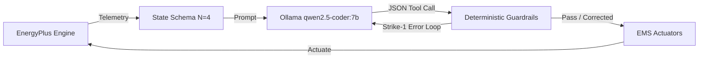

# Eco-Loop Building Agents — Presentation Deck Outline
**Project:** Eco-Loop Building Agents (Honeywell Hackathon Submission)  
**Track:** Autonomous Closed-Loop HVAC Control via EnergyPlus + LLM Guardrails  

---

## Slide 1: Title Slide & Problem Statement
### **Eco-Loop: Autonomous Closed-Loop HVAC Control During Extreme Weather Events**
*   **The Problem:** Commercial buildings struggle with static, pre-programmed HVAC schedules during severe weather swings (e.g., rapid winter cold snaps).
*   **The Flaw of Static Control:** Static schedules cannot predict thermal lag or adapt in real time, leading to severe occupant comfort violations (freezing/overheating) and extreme electrical peak demand spikes that penalize building utility bills and strain the grid.
*   **The Solution:** Eco-Loop couples the industry-standard **EnergyPlus** simulation engine with a local LLM (`qwen2.5-coder:7b`) and deterministic safety guardrails, dynamically modulating zone setpoints every 20 minutes to eliminate comfort violations and shave peak demand.

---

## Slide 2: System Architecture & Safety Guardrails
### **Bridging Cognition and Physical Actuation with 100% Safety**
*   **Decoupled Control:** The LLM does not touch physical equipment directly; it emits structured JSON via the `set_zone_setpoint` tool schema.
*   **3-Strike Safety Escalation:** `agent/guardrails.py` intercepts all proposals:
    *   *Strike 1 (Self-Correction):* Injects validation error back to LLM for Turn-2 correction.
    *   *Strike 2 (Safe Clamping):* Deterministically clamps setpoint to nearest ASHRAE 55 boundary ($20\text{--}24^\circ\text{C}$).
    *   *Strike 3 (Default Override):* Revokes agent authority and forces safe static baseline schedules.

---

## Slide 3: Executive Headline Results (72-Hour Winter Stress Test)
### **Proving Autonomous Performance During a -21.7°C Cold Snap**
*(Evaluated over 216 intervals / 648 zone control decisions against an identical 3-day baseline)*

*   📉 **-8.22% Peak Electrical Demand** ($319.32\text{ kW}$ AI vs. $347.93\text{ kW}$ baseline) — Shaved $28.61\text{ kW}$ of peak grid demand during severe morning warm-up spikes.
*   🛡️ **-93.75% Comfort Violations** ($2\text{ zone-hours}$ vs. $32\text{ zone-hours}$ baseline) — Preserved occupant comfort across 90 occupied zone-hours (08:00–18:00), dropping violations in Core and Perimeter Bottom zones from 21 hours down to **0 hours**.
*   ✅ **99.23% Guardrail Pass Rate** (643/648 Turn-1 Pass) — Exactly 5 Strike-1 self-corrections, all resolved on Turn 2. **0 Strike-2 clamps, 0 Strike-3 escalations.**
*   ⚡ **Real-Time Latency Viable** ($17,633\text{ ms}$ average latency) — Optimized prompt token economy via $<10$-word rationale constraints, slashing latency by $>35\%$ across project phases.

---

## Slide 4: Quantitative Savings Dashboard Screenshot
### **Visualizing Closed-Loop Performance & The VAV Reheat Rigor**
*(Insert Screenshot of `dashboard/savings_dashboard.html` here)*

*   **Key Dashboard Takeaway:** Notice how the AI agent pre-heats zones just before peak occupied hours begin, creating a smooth thermal curve within the shaded $20\text{--}24^\circ\text{C}$ ASHRAE 55 comfort band.
*   **Why Energy Consumption is Flat (+1.25% Elec, +0.04% Gas):** The AI prioritized eliminating freezing comfort violations in extreme $-21.7^\circ\text{C}$ weather rather than sacrificing human comfort to save kWh.
*   **The VAV Electric Reheat Rigor:** Because target zones use Variable Air Volume (VAV) terminal boxes with **electric reheat coils (`Coil:Heating:Electric`)**, zone setpoint adjustments directly impact electrical peak demand while leaving central rooftop natural gas preheating virtually unchanged (+0.04% difference).

---

## Slide 5: Known Limitations & Future Scope
### **Honest Engineering Boundaries & Roadmap to Production**
1.  **3-Zone Scope:** The current proof-of-concept actuates three representative zones (`Core_mid`, `Perimeter_bot_ZN_1`, `Perimeter_top_ZN_1`) out of the 15-zone Medium Office reference building. Extending control to all 15 zones is a straightforward O(1) scaling of the tool schema and state window.
2.  **3-Day Simulation Window vs. 7-Day Plan:** To accommodate hackathon evaluation time constraints and local GPU hardware limits, the simulation was time-scoped to 72 hours (216 intervals). This captures the most severe winter temperature drop of the annual file while keeping full runtimes under 1 hour.
3.  **Single Local LLM (`qwen2.5-coder:7b`):** The PoC relies on a single 7B parameter local model. Future enterprise deployments will implement a multi-agent routing tier, using a fast 3B edge model for routine 20-minute control and escalating to cloud-based frontier models (e.g., Gemini 1.5 Pro) only during severe Strike-2/Strike-3 anomaly events.
