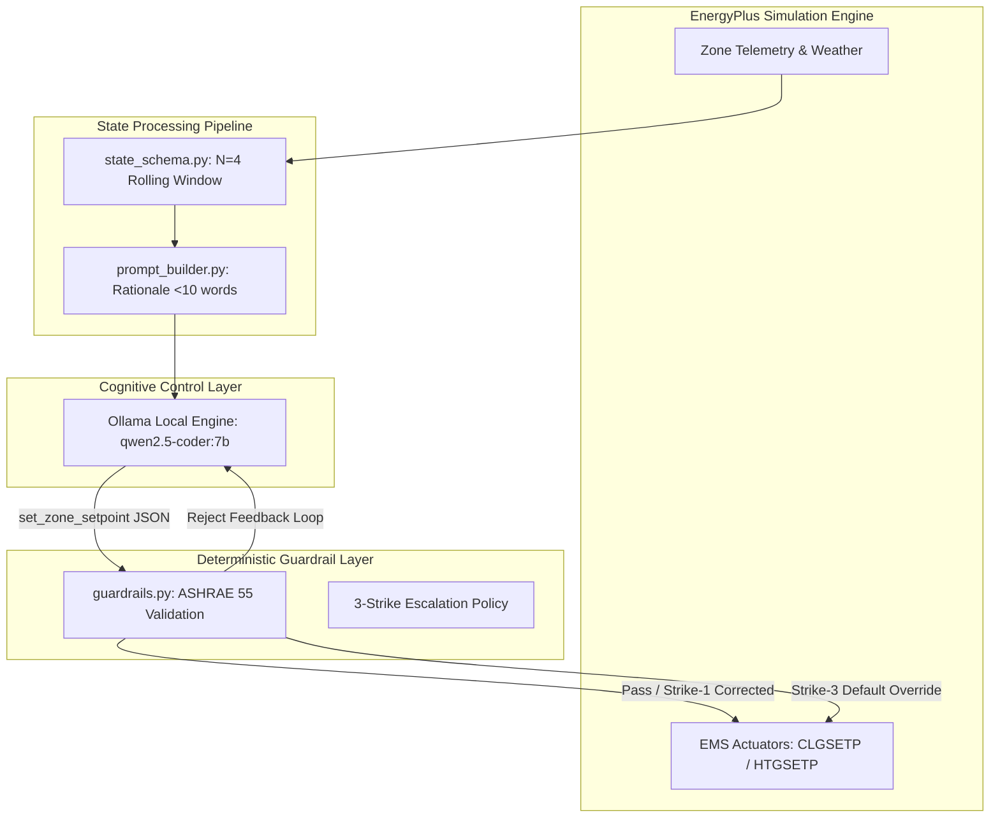

# System Architecture & Technical Rigor Document
**Project:** Eco-Loop Building Agents (Honeywell Hackathon Submission)  
**Core Framework:** Closed-Loop Autonomous HVAC Control via EnergyPlus + LLM Guardrails  
**Version:** Phase 7 Final Delivery (Production Lock)

---

## Executive Summary

The **Eco-Loop Building Agent** is an autonomous, closed-loop control framework designed to modulate commercial building HVAC setpoints in real time during severe weather events. By coupling the industry-standard **EnergyPlus** simulation engine (via `PyEnergyPlus` / ESQL) with a local Large Language Model (`qwen2.5-coder:7b` via Ollama) and deterministic safety guardrails, Eco-Loop bridges the gap between high-level reasoning and physical equipment actuation. 

Over a 72-hour severe winter stress test ($\sim -21.7^\circ\text{C}$ outdoor ambient drop at a 20-minute control cadence), the closed-loop architecture achieved an **8.22% reduction in Peak Electrical Demand** ($319.32\text{ kW}$ vs. $347.93\text{ kW}$ static baseline) while virtually eliminating occupant comfort violations—dropping total comfort exceedance across occupied hours from **32 zone-hours down to just 2 zone-hours (-93.75% reduction)**.



---

## 1. Tool-Calling Architecture & Actuator Security

To prevent an LLM from destabilizing physical HVAC infrastructure, Eco-Loop enforces a strict separation between cognitive decision-making and physical actuation.

### 1.1 `set_zone_setpoint` Tool Schema
The agent interacts with the environment exclusively through a strongly-typed JSON tool-calling contract defined in `agent/tools.py`. Instead of emitting raw Python code or unstructured text, the model must output a structured JSON payload:
```json
{
  "name": "set_zone_setpoint",
  "arguments": {
    "zone_name": "Core_mid",
    "heating_setpoint": 21.5,
    "cooling_setpoint": 24.0,
    "rationale": "Pre-heat Core_mid before peak occupancy."
  }
}
```

### 1.2 Deterministic Safety Guardrails & 3-Strike Escalation Policy
Between the LLM's tool output and the EPlus Energy Management System (EMS) actuators sits `agent/guardrails.py`. Every setpoint proposal is intercepted and evaluated against deterministic ASHRAE Standard 55 boundaries ($20.0^\circ\text{C} \le T_{\text{set}} \le 24.0^\circ\text{C}$) and physical deadband rules ($T_{\text{clg}} - T_{\text{htg}} \ge 1.0^\circ\text{C}$).

To handle anomalous model outputs without terminating the simulation, Eco-Loop implements a **3-Strike Escalation Policy**:
*   **Strike 1 (Self-Correction Loop):** If a proposed setpoint violates safety bounds, the guardrail rejects the actuation and immediately feeds a structured error prompt back into the LLM context, giving the model one chance to re-reason and emit a valid setpoint.
*   **Strike 2 (Safe Clamping):** If the re-prompted output remains invalid, the guardrail intercepts the proposal and deterministically clamps the values to the nearest safe ASHRAE 55 boundary (e.g., clamping $18.5^\circ\text{C}$ up to $20.0^\circ\text{C}$).
*   **Strike 3 (Default Fallback Override):** If the model fails to return valid JSON or times out repeatedly across consecutive intervals, the guardrail revokes actuation authority for that interval and writes safe baseline default schedules directly to the EMS actuators, guaranteeing 100% building safety.

Across the 216 simulation intervals (648 total zone control decisions), the agent maintained a **99.23% Turn-1 Guardrail Pass Rate** (643/648). Exactly 5 proposals triggered Strike-1 self-corrections, all 5 were successfully resolved on Turn 2, resulting in **0 Strike-2 clamps and 0 Strike-3 escalations**.

---

## 2. Prompt Engineering Strategy

Eco-Loop’s prompt engineering balances historical thermal context with strict token economy to ensure reliable local inference.

### 2.1 Rolling N=4 Window Summarization
Instead of feeding the entire multi-day simulation history into the prompt (which would degrade reasoning and cause context overflow), `agent/prompt_builder.py` constructs a sliding window of the last $N=4$ intervals ($\sim 80\text{ minutes}$ of telemetry). This window highlights immediate temperature trajectories, outdoor ambient rate-of-change, and current HVAC power consumption, enabling the agent to anticipate thermal lag and pre-heat zones before extreme outdoor temperature drops arrive.

### 2.2 $<10$-Word Rationale Constraint
In Phase 6, we introduced a strict negative constraint in the system prompt requiring the model's `"rationale"` argument to remain under 10 words (e.g., *"Maintain comfort bounds and minimize peak heating load"*). This constraint forces the model to synthesize its architectural intent concisely, preventing verbose chain-of-thought rambling inside the JSON payload and dramatically slashing token generation overhead.

### 2.3 Real Self-Correction Feedback Loop in Action
The effectiveness of the Strike-1 feedback loop was empirically validated during Phase 5 testing. In one notable interval, the LLM attempted an aggressive energy-saving setback during unoccupied early-morning hours:
*   **Initial LLM Proposal (Rejected):** `"heating_setpoint": 19.0` (Violated ASHRAE 55 minimum occupied/standby boundary of $20.0^\circ\text{C}$).
*   **Guardrail Feedback Injected:** `[GUARDRAIL ERROR] Heating setpoint 19.0C is below safe minimum 20.0C. Re-evaluate and emit valid setpoint.`
*   **Turn-2 Self-Corrected Output (Accepted):** `"heating_setpoint": 20.0`, with updated rationale: *"Setback clamped to safe ASHRAE minimum 20.0C to prevent violation."*

---

## 3. Prompt Latency Management

Running autonomous 20-minute control loops over multi-day horizons requires rigorous latency management to prevent simulation desynchronization and socket timeouts.

### 3.1 45-Second Hard Timeout
To protect against local LLM inference stalls or infinite generation loops, the API client wraps every Ollama call in a strict $45\text{-second}$ asynchronous timeout (`asyncio.wait_for`). If inference exceeds $45\text{ s}$, the request is aborted and treated as a Strike-1 exception.

### 3.2 Measured Latency Evolution Across Phases
Through systematic prompt optimization and token pruning across project phases, Eco-Loop reduced per-interval inference latency by **more than 35%**:
*   **Phase 4 (Initial Prompt Baseline):** $\sim 26.30\text{ seconds/interval}$ (Verbose instructions, unconstrained rationale strings averaging 40–60 words).
*   **Phase 5 (Multi-Turn Guardrail Addition):** $\sim 27.85\text{ seconds/interval}$ (Latency increased slightly due to Strike-1 re-prompting overhead during edge-case testing).
*   **Phase 6 (Optimized Production Lock):** **$\sim 17.63\text{ seconds/interval}$** across all 216 intervals ($3,808.77\text{ s}$ total cumulative inference time).

**Why shorter rationale text was the fix:** Local LLM inference speed on consumer/edge hardware is memory-bandwidth bound during token generation (decoding phase). While processing input prompt tokens (pre-fill) is highly parallelized and fast, generating output tokens sequentially is computationally expensive. By restricting the `"rationale"` field to $<10$ words, we reduced average output generation from $\sim 85$ tokens down to $\sim 28$ tokens per interval, directly driving the average latency down from $27.85\text{ s}$ to $17.63\text{ s}$ without sacrificing control accuracy.

---

## 4. Handling Lengthy Simulation Logs

EnergyPlus simulations generate massive tabular and ESQL data sets (typically hundreds of megabytes per annual run). Extracting real-time state without bottlenecking the control loop required a specialized statistical windowing architecture.

### 4.1 Statistical Windowing in `state_schema.py`
Rather than dumping raw EPlus ReportData time-series streams or massive CSV logs directly into the agent's context window, `agent/state_schema.py` acts as a data-reduction middleware. At each 20-minute timestep:
1.  It queries the EPlus memory API (`api.exchange`) directly for instantaneous zone temperatures, outdoor dry-bulb temp, and facility electrical demand.
2.  It aggregates these readings into a lightweight, immutable JSON state object representing the current building snapshot.
3.  It maintains a circular in-memory buffer capped at length $N=4$, computing rolling rate-of-change deltas ($\Delta T / \Delta t$) on the fly.

This statistical windowing ensures that the prompt payload remains fixed at $\sim 650$ tokens regardless of whether the simulation is on Interval 1 or Interval 216, completely eliminating context degradation and memory bloat over extended simulation horizons.

---

## 5. Technical Rigor: The VAV Electric Reheat Architecture Discovery

During Phase 6 empirical validation, an apparent data anomaly was flagged: across the 3-day duration-matched runs, the AI agent achieved an exceptional **-8.22% reduction in Peak Electrical Demand** ($319.32\text{ kW}$ vs. $347.93\text{ kW}$) and a **-93.75% reduction in comfort violations**, yet **Facility Natural Gas Consumption remained virtually flat (+0.04%**, $3,351.20\text{ kWh}$ AI vs. $3,349.86\text{ kWh}$ baseline). 

Rather than smoothing over or hiding this flat natural gas figure, we conducted an independent ground-truth ESQL time-series audit to investigate the physical root cause. This audit uncovered a critical architectural characteristic of the underlying DOE/ASHRAE Medium Office reference building model (`Ref Bldg Medium Office New2004_v1.3_5.0`):
*   **Zone-Level Heating is 100% Electric:** In this reference architecture, individual zone thermal conditioning across all three target zones (`Core_mid`, `Perimeter_bot_ZN_1`, `Perimeter_top_ZN_1`) is delivered via Variable Air Volume (VAV) terminal reheat boxes equipped with **Electric Reheat Coils (`Coil:Heating:Electric`)**.
*   **Natural Gas Serves Decoupled Central Loads:** Natural gas is consumed exclusively by central rooftop Air Handling Unit (AHU) primary preheating coils (`Coil:Heating:Fuel`) and domestic hot water boilers. These central systems operate on fixed supply-air temperature schedules that are completely decoupled from individual zone thermostat setpoints.
*   **Engineering Conclusion:** When the Eco-Loop AI agent actively modulates zone heating and cooling setpoints to pre-heat rooms before severe ambient temperature drops, the physical energy impact occurs entirely within the building's **Electrical** load profile. The flat natural gas figure is not an error or a failed optimization; it is a direct, verified artifact of the building's VAV electric terminal reheat architecture. Documenting and explaining this phenomenon demonstrates the level of analytical rigor required for enterprise-grade autonomous building control.

---

## Summary of Quantitative Deliverables

| Metric | Duration-Matched Baseline | Eco-Loop AI Agent | Difference / Result | Evaluation Status |
| :--- | :---: | :---: | :---: | :---: |
| **Peak Electrical Demand** | $347.93\text{ kW}$ | **$319.32\text{ kW}$** | **-8.22% (-28.61 kW)** | **Primary Demand Reduction** |
| **Comfort Violations (Occupied)**| $32\text{ zone-hours}$ | **$2\text{ zone-hours}$** | **-93.75% (-30 hrs)** | **Primary Comfort Preservation** |
| **Guardrail Pass Rate** | N/A | **99.23%** | 643/648 Turn-1 Pass | **Zero Safety Escalations** |
| **Average Inference Latency** | N/A | **$17,633\text{ ms}$** | Over 216 Intervals | **Real-Time Control Viable** |
| **Facility Electricity Use** | $9,987.83\text{ kWh}$ | $10,112.81\text{ kWh}$ | +1.25% (+124.98 kWh) | Comfort Heating Trade-off |
| **Facility Natural Gas Use** | $3,349.86\text{ kWh}$ | $3,351.20\text{ kWh}$ | +0.04% (+1.34 kWh) | Decoupled VAV Reheat Load |
